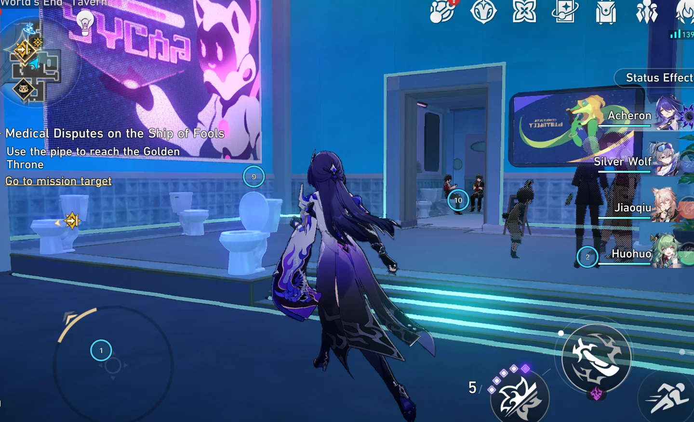

<p align="center">
  <a href="https://hematenergi.github.io/playcover-touch-bridge/">
    
  </a>
</p>

<h1 align="center">PlayCover Touch Bridge</h1>

<p align="center">Use your Android touchscreen to control PlayCover games on Mac, with independent multitouch and game video over USB.</p>

<p align="center">
  <a href="https://hematenergi.github.io/playcover-touch-bridge/">Website</a> ·
  <a href="#quick-start">Quick start</a> ·
  <a href="#compatibility">Compatibility</a> ·
  <a href="https://github.com/hematenergi/playcover-touch-bridge/issues">Report an issue</a>
</p>



Each finger reaches [PlayTools](https://github.com/PlayCover/PlayTools) as a separate touch inside the iOS game. Hold a virtual stick with one finger and move the camera with another. Android Chrome displays the game and sends touch input; there is no Android app to install.

An independent community project for [PlayCover](https://github.com/PlayCover/PlayCover), developed and tested with **Honkai: Star Rail**. The current launcher targets HSR; other games need adaptation.

## Compatibility

| Component | Tested with |
| --- | --- |
| Mac | Apple Silicon |
| PlayCover | 3.1.0 with PlayTools |
| Game | Honkai: Star Rail (global iOS) |
| Phone | Samsung Galaxy A54, Android Chrome |

You also need **Python 3, ADB and Xcode command-line tools** on the Mac, a USB connection, USB debugging authorized on the phone, and macOS Screen Recording permission for the capture helper or launching terminal. The game must already be installed in PlayCover.

Other Android devices and PlayCover versions have not been verified. To adapt the launcher for another game, see [SKILL.md](SKILL.md).

## Quick start

1. Get the project:

   ```sh
   git clone https://github.com/hematenergi/playcover-touch-bridge.git
   cd playcover-touch-bridge
   ```

2. Connect the phone by USB and authorize USB debugging.
3. Quit HSR if it is already open. The bridge must launch the game with its temporary touch module.
4. Double-click **Start.command** in the project folder, or run `./Start.command` in Terminal. Keep the Terminal window open.
5. Chrome opens on the phone automatically. Tap **Fullscreen**, turn the phone to landscape, and touch the game picture.

**Stop:** press **Ctrl+C** in the bridge Terminal. To play normally again, quit the game and reopen it through PlayCover. **Release touches** on the phone releases all held contacts.

## Stream and touch controls

### Video

Tap **Stream** on the phone to change settings without restarting the game.

| Preset | FPS | Width | JPEG quality |
| --- | --- | --- | --- |
| Responsive | 60 | 640 px | 35% |
| Balanced (default) | 60 | 960 px | 45% |
| Sharp | 30 | 1280 px | 70% |

Custom settings support 30/45/60 FPS, widths of 640/960/1280/1600 px, and JPEG quality of 20–90%. Tap **Apply** to save them for the next launch. These settings affect the video feed, not the game’s graphics settings. The FPS counter shows frames drawn by the phone browser, not the selected target.

### Toolbar

Drag the **⠿** handle to move the toolbar. **↔ / ↕** switches its orientation; the default is vertical at the left edge. The handle also supports arrow keys, and the toolbar stays inside the viewport after rotation or fullscreen changes.

Under **Stream → Toolbar**, choose the layout, normal opacity, faded opacity, and two-second auto-fade. Touch the toolbar to wake it; reset its position to return it to the left edge. These preferences save immediately in the phone’s local storage, separately from video settings.

### Mac touch markers

Enable **Touch markers on Mac** in **Stream** to see numbered contacts over the foreground game window. The transparent overlay follows the window and ignores mouse input. Markers hide when fingers lift, input expires, or another Mac app takes focus.

## How it works

The bridge captures the Mac game window and sends JPEG frames to Android Chrome. The phone sends independent touch contacts back to PlayTools’ touch API, allowing simultaneous UIKit touches rather than a fixed keyboard or pointer mapping.

The launcher injects a temporary module using `DYLD_INSERT_LIBRARIES`. It does not patch the installed game binary, PlayTools framework, or existing keymaps.

The host listens on Mac loopback ports **19470** and **19471**. ADB reverse provides USB access, and requests require a random session token. Closing the phone page or losing its heartbeat releases held touches, with a fallback timeout of about **3–4 seconds**.

## Limits and measured results

- **HSR-specific launcher.** The current game path is `~/Library/Containers/io.playcover.PlayCover/Applications/com.HoYoverse.hkrpgoversea.app`.
- **JPEG video, no audio forwarding.** Stream targets go up to 60 FPS. Actual performance depends on the game, Mac, and phone.
- **Restart after changing the game window’s orientation or aspect ratio.** Cropping uses its current aspect ratio and the Mac window’s title bar height.
- **Verified in use:** independent touch IDs, simultaneous UIKit touches, live video and working control on Galaxy A54, live resolution/quality changes, and numbered Mac touch markers. Not every mini game has been tested.
- **Observed video rate:** around 48–54 decoded FPS on the connected Galaxy A54 with a 60 FPS target, while switching between 640 px / 35% and 960 px / 45%. End-to-end latency and long-session stability have not been instrumented.

<details>
<summary>Video renderer notes</summary>

The browser requests the latest available frame after decoding the previous one, skipping older frames instead of accumulating an MJPEG playback queue. Frames use a native image element; the earlier desynchronized canvas could retain an old visible surface while its pixels and FPS counter updated.

Visual synchronization was checked against a contemporaneous server frame during the mini game. A retained browser frame cursor also recovers when the host’s frame counter resets.

</details>

## Development and removal

`TouchBridge.m` receives touches inside the game. `Capture.swift` captures window frames. `host.py` serves the browser UI in `index.html`.

**Do not share `build/session.json`: it contains the local session token.** Game output and capture diagnostics stay under `build/`.

<details>
<summary>Transport and toolbar checks</summary>

Run `python3 self_check.py` while the bridge is active for transport and authentication checks. It does not send game touches.

For the toolbar check, unlock the phone and show the bridge in Android Chrome, then run:

```sh
adb forward tcp:19472 localabstract:chrome_devtools_remote
node ui_check.mjs
adb forward --remove tcp:19472
```

The toolbar check requires Node 22+. It exercises touch dragging, input isolation, orientation, fade, opacity, viewport bounds, and persistence, then restores the original toolbar preferences. Remove the debug forwarding when finished, including if the check fails.

</details>

To remove the bridge, stop it, quit HSR, then delete the project folder and `~/Library/Containers/io.playcover.PlayCover/TouchBridge/`. Nothing auto-starts.

## Credits and feedback

Built by [Dany Arkham / hematenergi](https://github.com/hematenergi), also the author of [Fragment](https://github.com/hematenergi/fragment). Licensed under [MIT](LICENSE).

Built for [PlayCover](https://github.com/PlayCover/PlayCover), using [PlayTools](https://github.com/PlayCover/PlayTools) for touch input. This project is not an official PlayCover release.

[Report an issue](https://github.com/hematenergi/playcover-touch-bridge/issues) with your Mac and macOS version, PlayCover version, game, Android model, and what happened. Reports from other games are welcome; start with [SKILL.md](SKILL.md) when adapting the bridge.
